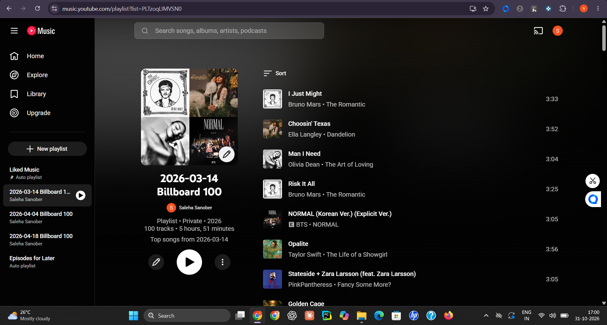

# 🎵 Musical Time Machine

A Python-based music discovery project that retrieves historical music chart data and finds the corresponding songs on YouTube Music.

## ✨ Features
- Select a date to explore historical music charts.
- Scrape song titles and artist names from a chart website.
- Search for matching songs on YouTube Music.
- Automate music discovery based on historical chart data.

## 📸 Project Preview

## 🛠️ Tech Stack
- Python
- BeautifulSoup
- Requests
- YouTube Music

## ⚙️ How It Works
1. Enter a date.
2. Retrieve the music chart data for that date.
3. Extract song titles and artist names.
4. Search for matching tracks on YouTube Music.

## 📚 Key Learnings
- Web scraping
- HTML parsing
- Working with external music platforms
- Python automation
- Data extraction and processing
